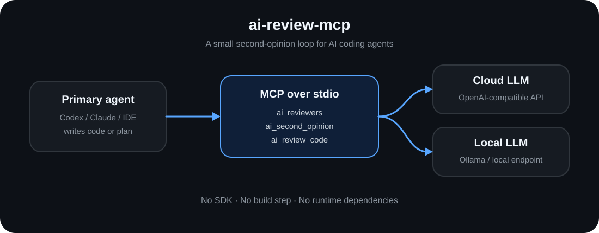

# ai-review-mcp

**English** | [中文](README.zh-CN.md)

[](https://github.com/purge-unlimited/ai-review/actions/workflows/verify.yml)
[](https://github.com/purge-unlimited/ai-review/releases)
[](package.json)
[](LICENSE)

A zero-dependency MCP server that asks a **second LLM** to review code, challenge a plan, or provide an independent opinion.

Useful when the primary agent has finished a change and you want another model to look for correctness bugs, edge cases, security issues, concurrency risks, performance problems, and requirement gaps.



## Why this exists

A single model can confidently miss its own mistakes. `ai-review-mcp` adds a simple second-opinion loop without a framework or database:

1. The primary agent writes code or a plan.
2. It calls one of this server's MCP tools.
3. A second cloud or local model reviews the artifact.
4. The primary agent receives a concise `P0`–`P3` finding list or an independent judgment.

No SDK. No build step. No runtime dependencies.

## Tools

| Tool | What it does |
|---|---|
| `ai_reviewers` | Lists configured backends and probes connectivity. Start here if the second model is not responding. |
| `ai_second_opinion` | Sends a question and optional context to another model for an independent judgment. |
| `ai_review_code` | Reviews inline code, a diff, or a file and returns severity-ranked findings. |

## Highlights

- **Zero npm dependencies** — only Node.js built-ins and global `fetch`.
- **Cloud or local** — OpenAI-compatible APIs, Ollama, DeepSeek, OpenAI, or another compatible endpoint.
- **Provider-neutral MCP transport** — newline-delimited JSON-RPC 2.0 over stdio.
- **Automatic config discovery** — can reuse the active provider in `${CODEX_HOME:-~/.codex}/config.toml`.
- **No secret echo** — API-key status is reported as configured or not configured; the value is never printed.
- **Developer-focused output** — asks the reviewer to report only substantive defects rather than generic style advice.

## Requirements

- Node.js 18 or newer
- One of:
  - an OpenAI-compatible cloud endpoint and API key;
  - a local OpenAI-compatible endpoint such as Ollama.

## Quick start

```bash
git clone https://github.com/purge-unlimited/ai-review.git
cd ai-review
npm test
```

Add the server to an MCP client that supports stdio servers. Replace `<ABSOLUTE_PATH_TO>` with the local clone path:

```json
{
  "mcpServers": {
    "ai-review": {
      "command": "node",
      "args": ["<ABSOLUTE_PATH_TO>/ai-review/server.js"],
      "env": {
        "AI_REVIEW_BACKEND": "auto"
      }
    }
  }
}
```

Restart the client after editing its MCP configuration.

## Example requests

Once registered, ask the primary agent to use the server:

```text
Call ai_review_code on the current diff. Focus on concurrency and error handling.
```

```text
Use ai_second_opinion to challenge this architecture decision. Include the attached constraints.
```

## Cloud backend

Cloud mode works with endpoints that implement OpenAI’s `POST /chat/completions`.

```text
AI_REVIEW_CLOUD_BASE_URL=https://provider.example/v1
AI_REVIEW_CLOUD_MODEL=<MODEL_NAME>
AI_REVIEW_CLOUD_API_KEY=<API_KEY>
```

If these variables are omitted, the server can inspect `${CODEX_HOME:-~/.codex}/config.toml` and discover the active Codex provider, endpoint, credential reference, and model catalog.

## Local backend

The default local endpoint is:

```text
http://127.0.0.1:11434/v1
```

Typical configuration:

```text
AI_REVIEW_LOCAL_BASE_URL=http://127.0.0.1:11434/v1
AI_REVIEW_LOCAL_MODEL=qwen3:8b
AI_REVIEW_LOCAL_AUTOSTART=off
```

Optional auto-start requires explicit paths:

```text
AI_REVIEW_LOCAL_AUTOSTART=auto
AI_REVIEW_LOCAL_NODE=<ABSOLUTE_PATH_TO_NODE>
AI_REVIEW_LOCAL_SERVER=<ABSOLUTE_PATH_TO_SERVER_ENTRY>
```

The server never assumes a machine-specific installation. If the local service is unavailable and auto-start is not configured, the tool returns a clear error.

## Configuration

| Variable | Default | Purpose |
|---|---|---|
| `AI_REVIEW_BACKEND` | `auto` | `auto`, `cloud`, or `local` |
| `AI_REVIEW_TIMEOUT_MS` | `180000` | Model request timeout |
| `AI_REVIEW_CLOUD_BASE_URL` | auto-discover | Cloud OpenAI-compatible base URL |
| `AI_REVIEW_CLOUD_MODEL` | auto-discover | Cloud model name |
| `AI_REVIEW_CLOUD_API_KEY` | auto-discover | Cloud credential |
| `AI_REVIEW_LOCAL_BASE_URL` | `http://127.0.0.1:11434/v1` | Local endpoint |
| `AI_REVIEW_LOCAL_MODEL` | `qwen3:8b` | Local model name |
| `AI_REVIEW_LOCAL_AUTOSTART` | `auto` | Start a configured local server on demand |
| `AI_REVIEW_LOCAL_NODE` | empty | Node executable used for local auto-start |
| `AI_REVIEW_LOCAL_SERVER` | empty | Server entry used for local auto-start |
| `CODEX_HOME` | `~/.codex` | Optional Codex config discovery directory |

See [`.env.example`](.env.example) for a complete template.

## Safety and privacy

- `ai_review_code` reads a file only when the caller explicitly supplies `path`.
- Inline content is capped at 160,000 characters; files are capped at 256 KiB.
- Review content is sent only to the selected backend.
- The server does not write prompts, responses, keys, or file content to disk.
- A cloud backend receives the reviewed content. Use the local backend when content must stay on the machine.
- Do not send secrets or personal data unless the selected backend is trusted.

## Development

```bash
npm run check
npm test
```

The test suite covers the MCP handshake, tool registry, and notification handling without contacting a model.

## License

MIT
