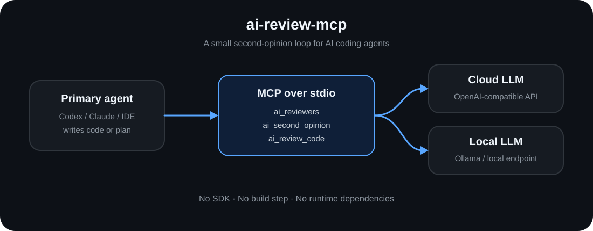

# ai-review-mcp

[English](README.md) | **中文**

[](https://github.com/purge-unlimited/ai-review/actions/workflows/verify.yml)
[](https://github.com/purge-unlimited/ai-review/releases)
[](package.json)
[](LICENSE)

一个零依赖 MCP 服务：让主 AI 在干活后调用**第二个模型**做代码审查、挑战方案或给出独立第二意见。

适合已经完成代码或方案，再让另一个模型检查正确性、边界条件、安全、并发、性能和需求遗漏的场景。



## 为什么需要它

单个模型容易漏掉自己刚犯的错误。`ai-review-mcp` 在中间加了一层很轻的第二意见回路：

1. 主 AI 完成代码或方案；
2. 调用本服务的 MCP 工具；
3. 云端或本地第二个模型独立审查；
4. 主 AI 收到 `P0`–`P3` 问题清单或独立判断。

不需要 SDK，不需要构建，不需要运行时依赖。

## 工具

| 工具 | 作用 |
|---|---|
| `ai_reviewers` | 列出后端并检查连通性。第二个模型不工作时先调这个。 |
| `ai_second_opinion` | 把问题与可选上下文交给另一个模型独立判断。 |
| `ai_review_code` | 审查代码、diff 或文件，返回带严重度的问题清单。 |

## 特点

- **零 npm 依赖**：只用 Node.js 内置模块和全局 `fetch`。
- **云端或本地**：支持 OpenAI 兼容接口、Ollama、DeepSeek、OpenAI 等。
- **通用 MCP stdio 传输**：换行分隔的 JSON-RPC 2.0。
- **自动发现配置**：可复用 `${CODEX_HOME:-~/.codex}/config.toml` 中当前 provider。
- **不回显密钥**：只报告密钥是否配置，不打印真实值。
- **面向工程问题**：要求审查模型只报告正确性、边界、安全、并发、性能和需求偏差。

## 环境要求

- Node.js 18 或更高版本
- 以下任一后端：
  - OpenAI 兼容云端接口和 API Key；
  - Ollama 等本地 OpenAI 兼容接口。

## 快速开始

```bash
git clone https://github.com/purge-unlimited/ai-review.git
cd ai-review
npm test
```

在支持 stdio 的 MCP 客户端中加入本服务，把 `<ABSOLUTE_PATH_TO>` 替换为本地路径：

```json
{
  "mcpServers": {
    "ai-review": {
      "command": "node",
      "args": ["<ABSOLUTE_PATH_TO>/ai-review/server.js"],
      "env": {
        "AI_REVIEW_BACKEND": "auto"
      }
    }
  }
}
```

修改 MCP 配置后重启客户端。

## 使用示例

```text
调用 ai_review_code 审查当前 diff，重点关注并发和错误处理。
```

```text
调用 ai_second_opinion 挑战这个架构决定，并把给定约束一起交给审查模型。
```

## 云端后端

云端模式要求接口实现 OpenAI 的 `POST /chat/completions`。

```text
AI_REVIEW_CLOUD_BASE_URL=https://provider.example/v1
AI_REVIEW_CLOUD_MODEL=<MODEL_NAME>
AI_REVIEW_CLOUD_API_KEY=<API_KEY>
```

不设置这些变量时，服务可以读取 `${CODEX_HOME:-~/.codex}/config.toml`，自动发现当前 Codex provider、接口地址、密钥引用和模型目录。

## 本地后端

默认本地接口：

```text
http://127.0.0.1:11434/v1
```

典型配置：

```text
AI_REVIEW_LOCAL_BASE_URL=http://127.0.0.1:11434/v1
AI_REVIEW_LOCAL_MODEL=qwen3:8b
AI_REVIEW_LOCAL_AUTOSTART=off
```

如果需要按需自动启动本地推理服务，必须显式提供路径：

```text
AI_REVIEW_LOCAL_AUTOSTART=auto
AI_REVIEW_LOCAL_NODE=<ABSOLUTE_PATH_TO_NODE>
AI_REVIEW_LOCAL_SERVER=<ABSOLUTE_PATH_TO_SERVER_ENTRY>
```

服务不假设任何固定安装位置。本地服务未运行且未配置自动启动时，会返回明确错误。

## 配置项

| 变量 | 默认值 | 用途 |
|---|---|---|
| `AI_REVIEW_BACKEND` | `auto` | `auto`、`cloud` 或 `local` |
| `AI_REVIEW_TIMEOUT_MS` | `180000` | 单次模型请求超时 |
| `AI_REVIEW_CLOUD_BASE_URL` | 自动发现 | 云端 OpenAI 兼容地址 |
| `AI_REVIEW_CLOUD_MODEL` | 自动发现 | 云端模型名 |
| `AI_REVIEW_CLOUD_API_KEY` | 自动发现 | 云端密钥 |
| `AI_REVIEW_LOCAL_BASE_URL` | `http://127.0.0.1:11434/v1` | 本地接口 |
| `AI_REVIEW_LOCAL_MODEL` | `qwen3:8b` | 本地模型名 |
| `AI_REVIEW_LOCAL_AUTOSTART` | `auto` | 是否按需启动已配置的本地服务 |
| `AI_REVIEW_LOCAL_NODE` | 空 | 本地自动启动使用的 Node 可执行文件 |
| `AI_REVIEW_LOCAL_SERVER` | 空 | 本地自动启动使用的入口脚本 |
| `CODEX_HOME` | `~/.codex` | Codex 配置发现目录 |

完整模板见 [`.env.example`](.env.example)。

## 安全与隐私

- 只有调用方明确传入 `path` 时，`ai_review_code` 才会读取文件。
- 内联内容上限为 160,000 字符；文件上限为 256 KiB。
- 审查内容只发送给选中的后端。
- 服务不会把提示词、响应、密钥或文件内容写入磁盘。
- 云端后端会收到待审查内容；内容必须留在本机时请使用本地后端。
- 除非信任所选后端，否则不要发送密钥、个人数据或其他敏感信息。

## 开发与测试

```bash
npm run check
npm test
```

测试覆盖 MCP 握手、工具注册和通知处理，不会调用真实模型。

## 许可证

MIT
